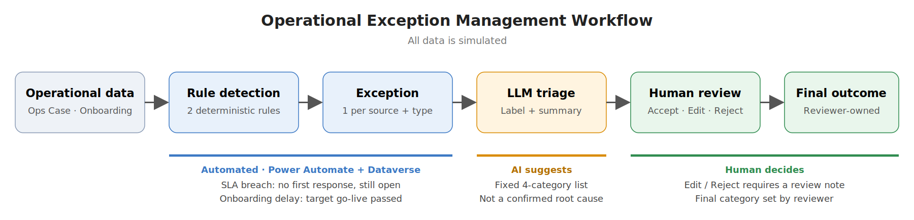
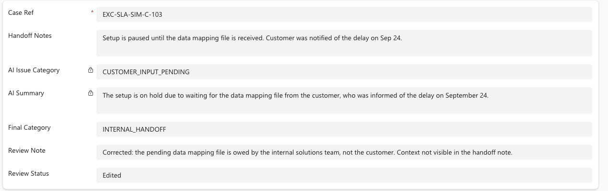
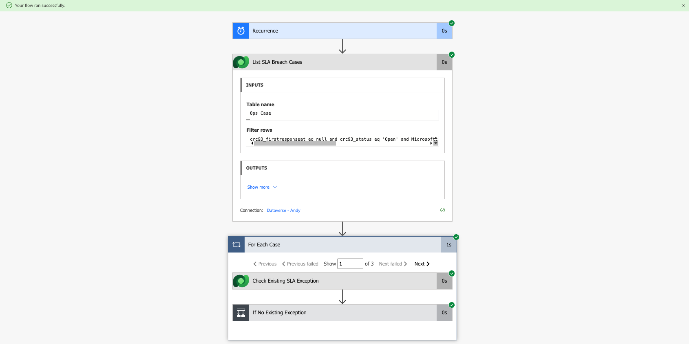

# B2B Operational Exception Management with Human-Reviewed AI Triage

**Status: Phase 3 complete (detection → AI triage → human review).** Portfolio prototype built on **simulated data only**. Not a production deployment or a real-company implementation.

| | |
| --- | --- |
| **Business problem** | In this simulated B2B operations scenario, SLA breaches and onboarding delays need to be surfaced consistently, while unstructured handoff notes require interpretation to triage each exception. |
| **Solution** | Deterministic rules flag exceptions; an LLM suggests a provisional category and summary from the handoff note; a human reviewer accepts, edits, or rejects it and sets the final outcome. |
| **Stack** | Microsoft Dataverse · Power Automate (scheduled + triggered flows) · Custom Connector to OpenAI `gpt-4o-mini` (strict JSON schema) · Dataverse model-driven form for review |
| **What was built** | 2 detection flows, 1 AI triage flow, an exception table with review fields, and a review form — tested end to end on simulated rows. |

## How the loop works

1. **Rule detection** (daily, deterministic — no AI)
   - **SLA breach:** case is `Open`, has no first response, and was opened more than 24 hours ago.
   - **Onboarding delay:** status is not `Completed` and the target go-live date has passed.
   - One exception per `Source ID + Exception Type`, so re-runs do not create duplicates.
2. **LLM triage:** When an exception is created, the AI triage flow uses the handoff note to suggest one category from a fixed list (`CUSTOMER_INPUT_PENDING`, `INTERNAL_HANDOFF`, `TECHNICAL_BLOCKER`, `OTHER_UNCLEAR`) and a short summary.
3. **Human review:** the reviewer sets `Review Status`, `Final Category`, and `Review Note`. AI fields are read-only on the form.
4. **Final outcome:** The saved Review Status records the final disposition (Accepted, Edited, or Rejected); a reviewer-set Final Category records the final classification where applicable.

## AI vs. human responsibility

| | AI | Human reviewer |
| --- | --- | --- |
| Role | Suggests a provisional label and summary | Sets Review Status and, where applicable, Final Category. |
| Authority | None — never the final outcome | `Accepted` / `Edited` / `Rejected` |
| Accountability | — | Under the documented review procedure, Edited and Rejected entries include a review note; the system does not enforce this rule. |

The AI category is a provisional label, not a confirmed root cause.

## Why human review matters

Two observations from the simulated test cases (not accuracy metrics):

- In simulated case `EXC-SLA-SIM-C-103`, the AI summary attributed the pending file to the customer, which the handoff note did not state. The reviewer marked the suggestion Edited, set Final Category to `INTERNAL_HANDOFF`, and recorded the reason in a review note.
- **`EXC-SLA-SIM-C-104`:** the case was already resolved, but the fixed category list has no "not an issue" option, so the AI picked `INTERNAL_HANDOFF`. The reviewer rejected it.

## Evidence

- [Phase 1 status — AI triage feasibility](docs/phase-1-status.md)
- [Phase 2 status — rule detection](docs/phase-2-status.md)
- [Phase 3 status — human review](docs/phase-3-status.md)
- [Dataverse schema](dataverse/schema.md) · [OpenAI connector definition](connector/openai-chat-completions.swagger.json) · [Sample case](samples/one-case.json)
- Full screenshot set: [docs/evidence/](docs/evidence/)

## Limitations

- **Simulated data only.** No claims about accuracy, time saved, or business impact.
- AI fields are read-only on the form only; they can still be edited in the table grid. Production would use security roles.
- Review rules (e.g. note required on Edited / Rejected) are a convention, not enforced by the system.
- For each Source ID and Exception Type pair, a second independent occurrence of the same type is not detected.
- The fixed category list has no "not an issue" value; such cases go through the `Rejected` path.
- No notifications, custom app, or production deployment.
